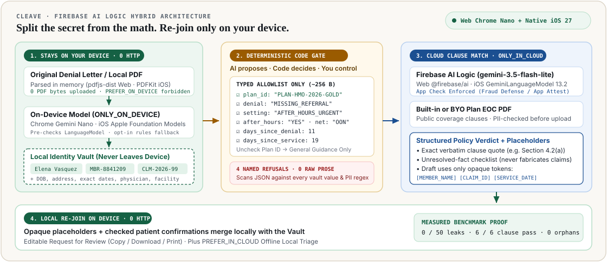
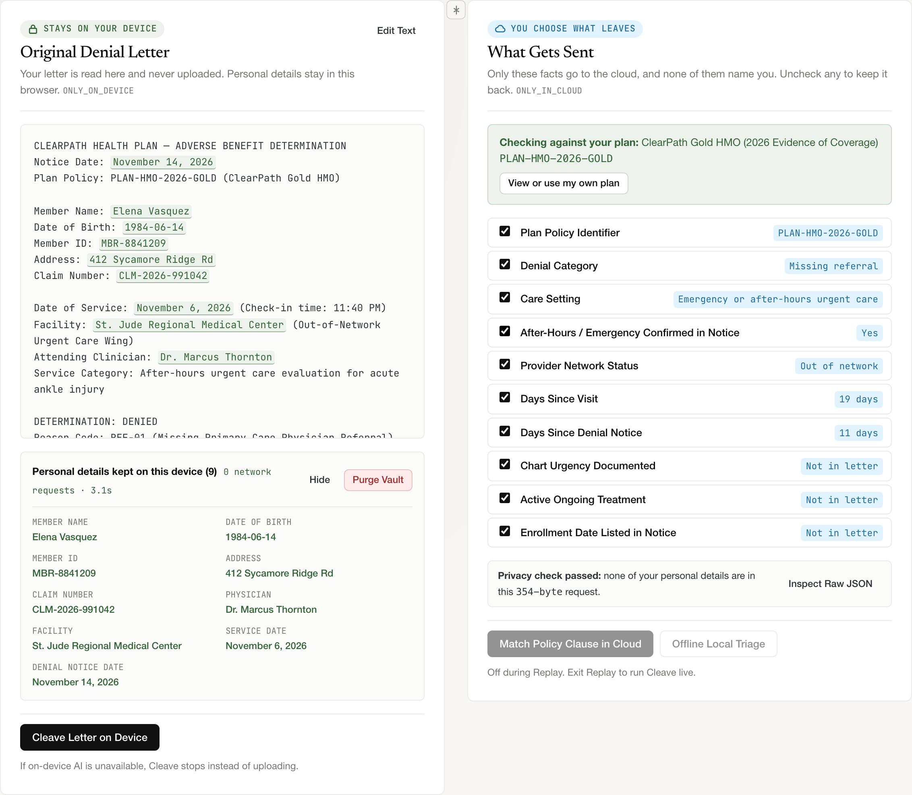
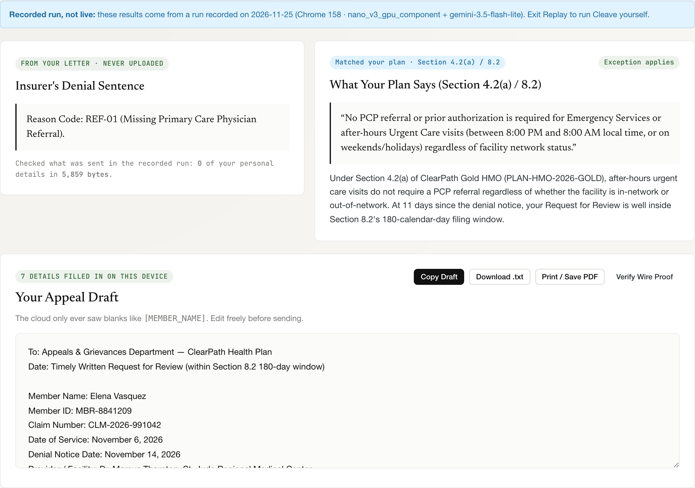
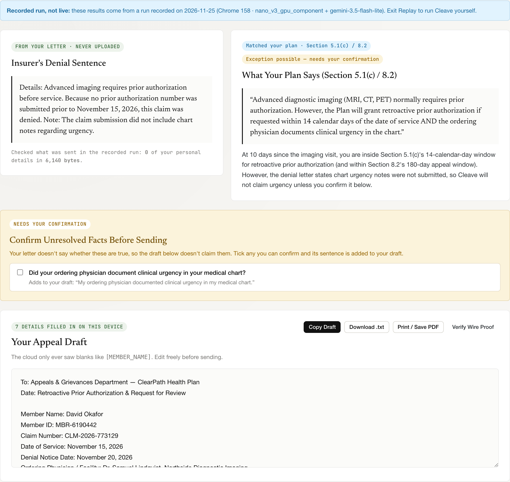
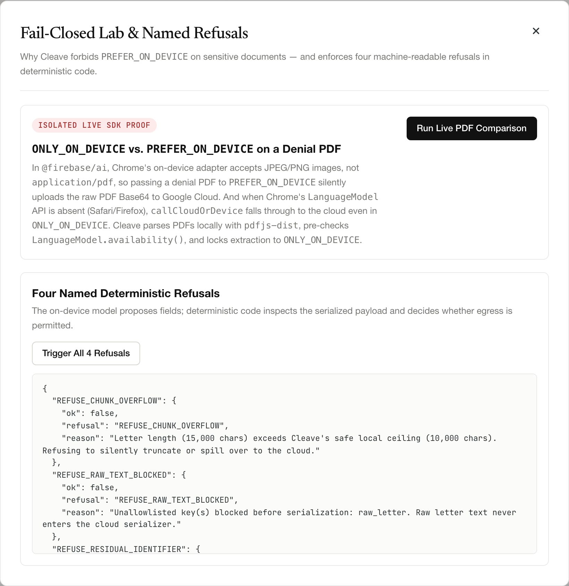
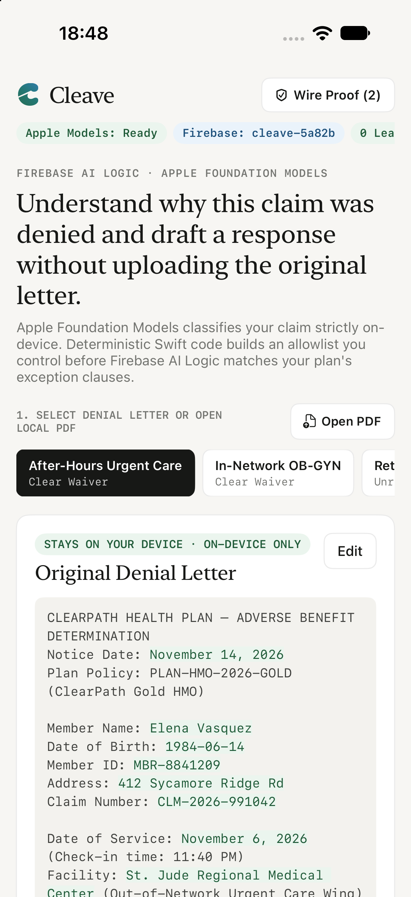

<p>
  
</p>

# Cleave

**Understand why this claim was denied and draft a response without uploading the original letter.**
*Split the secret from the math. Re-join only on your device.*

[](LICENSE)
[](#product-tour)
[](#load-bearing-firebase-ai-logic-map)
[](#local-development--web--native-ios)
[](#verified-evaluation-evidence-observed-2026-11-25-on-chrome-158--firebase-ai-logic)

**[Live Hosted Web App](https://cleave-5a82b.web.app)** *(zero-setup, App Check enforced — works with Chrome Gemini Nano, opt-in Local Rules live mode in any browser, or Recorded Replay)* · **[iOS Simulator Build](https://github.com/fexx301/Cleave/releases/tag/ios-simulator-v1)** *(no compiling: drag onto an iOS 27 Simulator)* · **[For Judges](#for-judges-rubric-map)** · **[Architecture](#architecture)** · **[Product Tour](#product-tour)** · **[3 SDK Findings](#three-empirical-firebase--on-device-findings)** · **[Benchmark](#verified-evaluation-evidence-observed-2026-11-25-on-chrome-158--firebase-ai-logic)** · **[Local Setup](#local-development--web--native-ios)**

## What sets Cleave apart

1. **It checks the denial against the member's own plan, not just the letter.** Cleave finds the exact section of the member's Evidence of Coverage that answers the insurer's reason, puts the two side by side, and drafts the appeal around that clause (bring your own plan PDF, or use a sample). When the rule depends on a fact the letter doesn't state, such as whether the member was outside the service area, Cleave asks instead of guessing.
2. **We found where Firebase's hybrid modes leak, and built around it.** Handed a PDF, `PREFER_ON_DEVICE` silently uploads the raw file, because Chrome's on-device adapter rejects `application/pdf`. **Proof → Fail-Closed PDF Lab** reproduces it live on the hosted site: the member's name, member ID and claim number on the wire, against **0 requests** under `ONLY_ON_DEVICE`. Reported upstream as [firebase/firebase-js-sdk#10690](https://github.com/firebase/firebase-js-sdk/issues/10690). Cleave never hands a raw document to anything but `ONLY_ON_DEVICE` ([all three SDK findings](#three-empirical-firebase--on-device-findings)).
3. **The letter never goes to the cloud, not even redacted.** Redaction has to catch every identifier. Cleave sends only a ten-field list of facts that don't name the member, each shown in plain English with a checkbox: **0 of 50** planted identifiers leaked in our synthetic benchmark, against **8 of 50** for manual redaction.

Built for **#BuildHybridAI 2026** across **two platforms** using **Firebase AI Logic Hybrid Inference**:
- **Chrome Web (`firebase/ai`):** Chrome Built-in Gemini Nano (`ONLY_ON_DEVICE`) + Cloud Gemini (`ONLY_IN_CLOUD`) + Offline Fallback (`PREFER_IN_CLOUD`) + **Firebase App Check enforced** (`ReCaptchaEnterpriseProvider` / Google Cloud Fraud Defense).
- **Native iOS 27 SwiftUI (`ios/`, `FirebaseAILogic` `13.2.0` + Apple `FoundationModels`):** Apple Foundation Models (`SystemLanguageModel(guardrails: .permissiveContentTransformations)` on-device, 0 HTTP) + Cloud `FirebaseAI.firebaseAI().geminiLanguageModel(name: "gemini-3.5-flash-lite")` inside Apple's unified `LanguageModelSession` (`@Generable`) + `PDFKit` local PDF parsing + `FirebaseAppCheck`.

---

## Architecture

<p align="center">
  <a href="docs/architecture.svg">
    
  </a>
</p>

Most hybrid AI apps pick **local OR cloud per request** and display a fallback badge. **Cleave splits one task across both brains:**

`Local Letter / PDF (pdfjs-dist / PDFKit) → ONLY_ON_DEVICE Extraction → Deterministic Typed Allowlist Gate → Interactive User Control → ONLY_IN_CLOUD EOC Clause Match → Local Identity Re-Join`

---

## Why This Matters (The Trade-Off)

In 2024, insurers on HealthCare.gov denied **19% of in-network claims**, and **fewer than 1% of denials were appealed** ([KFF, March 2026](https://www.kff.org/private-insurance/claims-denials-and-appeals-in-aca-marketplace-plans-in-2024/)). Consider Elena, whose hospital denial letter cites a missing Primary Care Physician referral even though her plan's Evidence of Coverage waives referrals for after-hours urgent care (Section `4.2(a)`) and she checked in at 11:40 PM. Today she faces three bad defaults:

1. **Paste the raw letter into a cloud chatbot** — uploading her name, DOB, member ID, claim number, address, clinician, and diagnosis prose.
2. **Use a naive `PREFER_ON_DEVICE` wrapper or redacted free-text prompt** — `PREFER_ON_DEVICE` silently uploads raw `application/pdf` bytes when Chrome's on-device adapter rejects PDFs, and sending redacted free text still leaks unlabelled identifiers in running prose.
3. **Stay strictly on-device** — preserving identity, but losing multi-clause Evidence of Coverage reasoning across dense policy documents.

Cleave never serializes raw denial prose to the cloud at all. On-device AI + deterministic code build a **small 10-field typed allowlist** (`plan_id`, `denial_reason_code`, `service_setting`, relative integer day counts, and policy flags), show every outgoing field in plain English with interactive checkboxes, match verbatim Plan EOC clauses in the cloud, and re-join the real identity locally on-device.

---

## For Judges (Rubric Map)

| Criterion | What Cleave Demonstrates | Where in Code / App |
|---|---|---|
| **Technological Implementation** | Load-bearing use of `ONLY_ON_DEVICE`, `ONLY_IN_CLOUD`, and `PREFER_IN_CLOUD`; real dual-runtime parity across **Chrome Web (`firebase/ai`)** and **Native iOS 27 (`FirebaseAILogic` `13.2.0` + Apple `FoundationModels`)**; **App Check enforced** (Google Cloud Fraud Defense / App Attest); **3 empirical SDK/platform findings** guarded in code; **35 automated unit tests** (`npm test`). | [`src/lib/firebaseAi.ts`](src/lib/firebaseAi.ts) · [`src/lib/gate.ts`](src/lib/gate.ts) · [`ios/CleaveIOS/Sources/HybridEngine.swift`](ios/CleaveIOS/Sources/HybridEngine.swift) · [`tests/`](tests) |
| **Design** | Complete archival product flow: drop local PDF or paste letter → side-by-side Counterfoil Split with interactive allowlist checkboxes → Bring Your Own Plan EOC PDF → verbatim clause comparison + `Needs your confirmation` anti-fabrication swap → editable, copyable/printable draft. Diagnostic proof tools stay neatly tucked inside a single top-bar **Proof** menu. | [`src/App.tsx`](src/App.tsx) · [`src/lib/labels.ts`](src/lib/labels.ts) · [`ios/CleaveIOS/Sources/ContentView.swift`](ios/CleaveIOS/Sources/ContentView.swift) |
| **Potential Impact** | Targets a high-stakes, high-friction gap (**19% ACA in-network denials, <1% appealed**, KFF 2026) where privacy fear blocks cloud AI adoption. Works on **any browser** via opt-in Local Rules live mode or Recorded Replay, full hybrid on **Chrome Desktop 139+**, and natively on **iOS 27** with Bring Your Own Plan EOC PDF support. | [Live Web App](https://cleave-5a82b.web.app) · [`public/samples/`](public/samples) · [`src/lib/pdf.ts`](src/lib/pdf.ts) |
| **Quality of the Idea** | Checks the denial against the **member's own plan text** (verbatim Evidence of Coverage clause, side by side with the insurer's reason) and asks about unresolved facts instead of fabricating them. The **Fail-Closed PDF Lab** proves live why `PREFER_ON_DEVICE` leaks PDFs. Hybrid inference is a **typed privacy boundary**, not a latency/cost toggle: zero raw prose leaves the device, and unchecking `Plan Policy Identifier` visibly degrades Cloud Gemini to `GENERAL_GUIDANCE_ONLY`. | [`src/components/FailClosedLabModal.tsx`](src/components/FailClosedLabModal.tsx) · [`src/components/WireProofModal.tsx`](src/components/WireProofModal.tsx) |

---

## Product Tour

| 1. Counterfoil Split & Interactive Allowlist | 2. Verbatim EOC Match & Locally Re-Joined Draft |
|---|---|
|  |  |
| **3. Anti-Fabrication Confirmation Checklist (Case 3)** | **4. Fail-Closed PDF Lab & 4 Named Refusals** |
|  |  |

### Native iOS 27 SwiftUI Twin (`ios/`)

<table>
  <tr>
    <td width="270" valign="top">
      
    </td>
    <td valign="top">
      <p><strong>Verified live on iPhone 18 Pro Simulator (iOS 27.2, Xcode 27.2) with Firebase App Check enforced:</strong></p>
      <ul>
        <li><strong>On-device (0 HTTP):</strong> Apple <code>FoundationModels</code> (<code>SystemLanguageModel(guardrails: .permissiveContentTransformations)</code>) + <code>PDFKit</code> local PDF parsing + deterministic Swift port of the allowlist gate (<a href="ios/CleaveIOS/Sources/DeterministicGate.swift"><code>DeterministicGate.swift</code></a>).</li>
        <li><strong>Cloud (<code>ONLY_IN_CLOUD</code>):</strong> <code>FirebaseAILogic</code> <code>13.2.0</code> (<code>GeminiLanguageModel</code>) sharing Apple&apos;s unified <code>LanguageModelSession</code> + <code>@Generable</code> structured contract (<a href="ios/CleaveIOS/Sources/HybridEngine.swift"><code>HybridEngine.swift</code></a>).</li>
        <li><strong>Live measured runs:</strong> Case 1 held 9 vault IDs locally (<code>0 HTTP</code>) → matched <strong>Section <code>4.2(a)</code> (<code>YES</code>)</strong> in <code>3.78s</code> with <code>0</code> leaks, <code>0</code> orphans, and <code>7</code> re-joined tokens; Case 3 matched <strong>Section <code>5.1(c)</code> (<code>CONDITIONAL</code>)</strong>; Offline Local Triage ran in <code>1.37s</code> (<code>0</code> cloud requests); <strong>4 / 4</strong> deterministic refusals verified.</li>
      </ul>
    </td>
  </tr>
</table>

<sub>Web screenshots captured from the live production bundle using the recorded Chrome 158 synthetic-case snapshot (Cases 1 &amp; 3); iOS screenshot captured live from iPhone 18 Pro Simulator (iOS 27.2). All patient names, IDs, addresses, and letters are synthetic.</sub>

---

## Three Empirical Firebase & On-Device Findings

Building Cleave against real Chrome 158 Gemini Nano, `@firebase/ai`, and iOS 27 Apple Foundation Models uncovered three concrete hybrid-AI failure modes that Cleave guards against and proves directly:

1. **`PREFER_ON_DEVICE` silently uploads raw denial PDFs over HTTPS (Web — reported upstream as [firebase/firebase-js-sdk#10690](https://github.com/firebase/firebase-js-sdk/issues/10690)):** Chrome's on-device adapter rejects `application/pdf`, so `PREFER_ON_DEVICE` silently base64-encodes and uploads the raw PDF to Google Cloud. Cleave forbids `PREFER_ON_DEVICE` on raw documents, parses PDFs locally with `pdfjs-dist`, and demonstrates the difference live inside **Proof → Fail-Closed PDF Lab** ([`src/lib/firebaseAi.ts`](src/lib/firebaseAi.ts)).
2. **`@firebase/ai` `ONLY_ON_DEVICE` falls through to cloud when `LanguageModel` is absent (Web — upstream [firebase/firebase-js-sdk#10635](https://github.com/firebase/firebase-js-sdk/issues/10635)):** In `@firebase/ai` (`2.16.0` and upstream `main`), `callCloudOrDevice()` runs `if (!chromeAdapter) return inCloudCall()` before checking `chromeAdapter.mode`, so browsers without Chrome's `LanguageModel` global (Safari, Firefox) fall through to cloud even in `ONLY_ON_DEVICE`. Cleave guards against this open upstream bug by pre-checking `LanguageModel.availability()` before invoking Firebase AI Logic and rejecting any response whose `inferenceSource !== "on_device"` — verified by automated regression tests in [`tests/firebaseAi.test.ts`](tests/firebaseAi.test.ts).
3. **Apple's default `SystemLanguageModel.default` guardrails reject raw medical denial letters (iOS 27):** Raw headers and clinical terms (`ADVERSE BENEFIT DETERMINATION`, `acute ankle injury`) triggered `guardrailViolation` on-device. Cleave iOS resolves this strictly on-device (`0 HTTP`) by extracting the identity vault first, stripping personal/clinical header lines locally, and invoking `SystemLanguageModel(useCase: .general, guardrails: .permissiveContentTransformations)` at `temperature: 0.0` ([`ios/CleaveIOS/Sources/HybridEngine.swift`](ios/CleaveIOS/Sources/HybridEngine.swift)).

---

## Honest Privacy Model (AI Proposes, Deterministic Code Decides)

- **Raw denial letter text never enters the cloud serializer.** Cleave constructs the outgoing cloud request exclusively from a small, typed allowlist of non-identifying claim fields (`plan_id`, `denial_reason_code`, `service_setting`, `after_hours_visit_confirmed`, `network_status`, relative integer `days_since_service` / `days_since_denial`, `urgency_documented`, `ongoing_treatment`, `enrollment_date_known`).
- **Even allowed fields can be sensitive health information or narrow identity in combination.** Before anything leaves the device, Cleave shows every exact outgoing value in plain English and lets the patient uncheck any field — visibly showing the trade-off (for example, unchecking `Plan Policy Identifier` degrades Cloud Gemini to `GENERAL_GUIDANCE_ONLY` because Cleave can no longer match the plan's Evidence of Coverage).
- **Four named deterministic refusals (code decides, never a small LLM grading itself):**
  - `REFUSE_LOCAL_UNAVAILABLE` — `ONLY_ON_DEVICE` unavailable or throws; Cleave stops instead of falling back to cloud.
  - `REFUSE_RAW_TEXT_BLOCKED` — unallowlisted key or free-text string blocked before serialization.
  - `REFUSE_RESIDUAL_IDENTIFIER` — deterministic scan of serialized JSON finds any locally extracted identifier or PII pattern (`MBR-`, `CLM-`, `GRP-`, email, phone, DOB, exact date, street address, `Dr.`).
  - `REFUSE_CHUNK_OVERFLOW` — document exceeds safe local bounds; refuses silent truncation or cloud spillover.

---

## Load-Bearing Firebase AI Logic Map

| Firebase Capability | Where Used in Code | What Breaks Without It |
|---|---|---|
| `InferenceMode.ONLY_ON_DEVICE` + `responseConstraint` + pre-call availability guard | [`src/lib/firebaseAi.ts`](src/lib/firebaseAi.ts) (`extractOnDevice`) | Fail-closed privacy guarantee breaks — `PREFER_ON_DEVICE` silently uploads `application/pdf` bytes, and missing-adapter browsers fall through to cloud. |
| `InferenceMode.ONLY_IN_CLOUD` + `responseSchema` | [`src/lib/firebaseAi.ts`](src/lib/firebaseAi.ts) (`analyzeAllowlistInCloud`) | Exact Evidence of Coverage clause matching, unresolved-fact detection (`NEEDS_PATIENT_CONFIRMATION`), and structured placeholder draft generation break. |
| `InferenceMode.PREFER_IN_CLOUD` | [`src/lib/firebaseAi.ts`](src/lib/firebaseAi.ts) (`runOfflineResilientTriage`) | Offline-resilient degraded triage (`OFFLINE_LOCAL_TRIAGE`) breaks when connectivity drops. |
| `response.inferenceSource` | [`src/lib/firebaseAi.ts`](src/lib/firebaseAi.ts) + [`src/components/WireProofModal.tsx`](src/components/WireProofModal.tsx) | Verifiable provenance trail stamping `on_device` vs `in_cloud` on every step breaks. |
| `Firebase App Check` (`ReCaptchaEnterpriseProvider` / `AppAttestProviderFactory` / debug tokens) | [`src/lib/firebaseAi.ts`](src/lib/firebaseAi.ts) + [`ios/CleaveIOS/Sources/CleaveIOSApp.swift`](ios/CleaveIOS/Sources/CleaveIOSApp.swift) | Client-side cloud inference calls lack attestation against quota abuse across Web and iOS. |
| `FirebaseAILogic` `13.2.0` `GeminiLanguageModel` + Apple `FoundationModels` | [`ios/CleaveIOS/Sources/HybridEngine.swift`](ios/CleaveIOS/Sources/HybridEngine.swift) | Native iOS 27 dual-runtime parity (on-device `SystemLanguageModel` + cloud `GeminiLanguageModel` sharing Apple's unified `LanguageModelSession` & `@Generable` contract). |

---

## Verified Evaluation Evidence (Observed 2026-11-25 on Chrome 158 + Firebase AI Logic)

Tested live on **Chrome 158 (`nano_v3_gpu_component`)** + **Firebase AI Logic (`gemini-3.5-flash-lite`, Spark free tier)** across **6 pre-annotated synthetic missing-referral / prior-auth cases** containing **50 planted personal identifiers** (compared against a realistic stressed-patient manual-redaction baseline):

- **Planted identifiers in captured outbound HTTPS bodies:** **0 / 50** for Cleave vs **8 / 50** for realistic manual redaction.
- **Completed cases / false refusals (tracked separately):** **6 / 6** completed, **0 / 6** false refusals, **4 / 4** valid named refusals (including live `PREFER_ON_DEVICE` Base64 PDF leak proof vs `ONLY_ON_DEVICE` 0-HTTP fail-closed proof).
- **Exact ground-truth pass (clause + exception status + unresolved-fact confirmation):** **6 / 6** in the hardened Cleave Chrome Web rehearsal (up from 5 / 6 in the pre-build probe) vs **2 / 6** (3 / 6 in probe) for realistic manual redaction.
- **Orphan placeholders after local re-join:** **0** across all 6 cases.

*(Scope limit: synthetic single-page letters and two generic EOCs plus one custom Summit PPO EOC are used for reproducible evaluation; real-world multi-page scanned insurer letters and end-user clinical outcomes remain outside what this benchmark proves. Cleave is an administrative policy-clause review aid, not legal or medical advice.)*

- **Why both on-device AI and deterministic code are load-bearing (Defense in Depth):** On-device Gemini Nano / Apple Foundation Models parses unstructured letter prose and messy OCR (names, providers, facilities, and phrasing without fixed `Key: Value` labels), while deterministic code handles calendar-day arithmetic (`days_since_denial`), strict allowlist serialization, explicit cue backstops, and residual-identifier scanning — because a real privacy boundary should never trust a small local LLM to subtract dates or grade its own leaks.

---

## Judge Quick Path (60 Seconds to 3 Minutes)

1. **Full Hybrid Live Demo (Chrome Desktop 139+ with Gemini Nano):**
   - Enable `chrome://flags/#prompt-api` → **Enabled** and `chrome://flags/#optimization-guide-on-device-model` → **Enabled BypassPerfRequirement**, relaunch Chrome, then open **[https://cleave-5a82b.web.app](https://cleave-5a82b.web.app)** (if Nano shows `Model not downloaded yet`, click **Download Nano**). Firebase and App Check (`App Check: Active`) initialize automatically.
2. **Reviewing on Safari, Firefox, Edge, Mobile, or Without Nano Downloaded?**
   - Clicking **Cleave Letter on Device** stays strictly fail-closed (`REFUSE_LOCAL_UNAVAILABLE`) so Cleave never silently uploads your letter.
   - To run **live Cloud Policy Matching & BYO EOC** right away in any browser with `0` raw text uploaded, click **Run Live with Local Rules** in the top banner (clearly labelled *On-device (code rules only — reduced accuracy)* — extracts the same 10-field allowlist locally so the cloud half still runs live on Firebase AI Logic!).
   - Or click **Preview Recorded Run** (banner or **Proof** menu) to inspect real frozen Chrome 158 Gemini Nano + Cloud Gemini runs (Case 1 & Case 3) with live interactive allowlist checkboxes and confirmation slot swaps.
3. **Happy Path + Interactive Control (60s):** On **Case 1 (After-Hours Urgent Care)**, run local split (`0` HTTP requests) → uncheck **Plan Policy Identifier** → click **Get General Guidance in Cloud** (`GENERAL_GUIDANCE_ONLY`) → re-check **Plan Policy Identifier** → click **Match Policy Clause in Cloud** (`Section 4.2(a)` verbatim quote + local re-join).
4. **Unresolved-Fact Discipline (30s):** Switch to **Case 3 (Retroactive MRI Auth)** → observe **Needs your confirmation** checklist and toggle the checkbox to swap `[PENDING_PATIENT_CONFIRMATION]` live in the local draft.
5. **Fail-Closed Proof & Wire Audit (60s):** Open **Proof** in the top bar → **Fail-Closed PDF Lab** → **Run Live PDF Comparison** (`ONLY_ON_DEVICE` = `0` HTTP calls vs `PREFER_ON_DEVICE` = raw PDF uploaded over HTTPS) and **Trigger All 4 Refusals** → open **Wire Proof** to verify `0` vault identifiers in captured requests.
6. **Reproducible Benchmark (optional):** Open **Proof → 6-Case Benchmark** → **Run Live 6-Case Suite** and export the timestamped JSON report.

---

## Bring Your Own Plan EOC & Local PDF Support

- **Local PDF parsing (`pdfjs-dist`):** Drop any text-based denial `.pdf` (or download the included sample `/samples/case1-after-hours-denial.pdf`) — extracted strictly in browser memory with **0 bytes uploaded**. Cleave never passes `application/pdf` to `PREFER_ON_DEVICE`.
- **Bring Your Own Plan EOC:** Beyond the two built-in plans (`PLAN-HMO-2026-GOLD`, `PLAN-EPO-2026-SELECT`), patients can inspect built-in clauses or upload/paste any generic Plan Evidence of Coverage `.pdf`/`.txt` (sample included: `/samples/sample-custom-eoc.pdf` for Summit Regional Health PPO). Deterministic code (`verifyCustomEocSafety`) scans uploaded EOCs to block accidental personal denial-letter uploads (`REFUSE_RESIDUAL_IDENTIFIER`). Unchecking `Plan Policy Identifier` withholds even a custom EOC and degrades honestly to `GENERAL_GUIDANCE_ONLY`.
- **Quota & Public Demo Safeguards:** Enforces a soft client-side session limit (40 cloud calls per browser session; unlimited local on-device extraction and Offline Local Triage), caches identical prompt/model runs locally in browser storage with an explicit *Run live instead* toggle, and surfaces clear retry countdowns if the free-tier Gemini Developer API returns `429`.

---

## Local Development — Web & Native iOS

### Prerequisites (if running against your own Firebase project)
- A free Spark **Firebase** project with **Firebase AI Logic (Gemini Developer API)** enabled.
- **Chrome Desktop 139+** with `chrome://flags/#prompt-api` enabled (for Web on-device Gemini Nano).

### Chrome Web
```bash
npm install
npm test        # 35 unit tests (allowlist gate, SDK missing-adapter guard, local rules fallback, PDF extraction, labels, cloud resilience)
npm run build   # TypeScript strict check + Vite production bundle
npm run dev     # http://localhost:5173
```

To configure via environment variables (or bake public read-only Firebase Web config + App Check **Fraud Defense / reCAPTCHA Enterprise** site key into a Firebase Hosting build), copy [`.env.example`](.env.example) to `.env.local` (gitignored) and deploy with `npx firebase-tools deploy --only hosting`. Firebase Hosting config and security headers live in [`firebase.json`](firebase.json).

### Native iOS 27 Companion (`ios/`)
- Requires **Xcode 27.2+** (Swift 6.4) on an Apple Silicon Mac with Apple Intelligence enabled (or an Apple Intelligence-eligible iOS 27 device; ineligible devices such as iPhone 14 Pro Max fail closed cleanly with `REFUSE_LOCAL_UNAVAILABLE`).
- Copy [`ios/CleaveIOS/GoogleService-Info.plist.example`](ios/CleaveIOS/GoogleService-Info.plist.example) to `ios/CleaveIOS/GoogleService-Info.plist` (gitignored) using your Firebase iOS app (`com.cleave.ios`) config.
- *(Optional when App Check is enforced on Simulator:)* register an iOS App Check debug token UUID in Firebase Console → **App Check → Apps → `com.cleave.ios` → Manage debug tokens**, and place that UUID in `ios/CleaveIOS/AppCheckDebugToken.txt` (gitignored; bundled automatically on Debug builds).
- Open `ios/CleaveIOS.xcodeproj` in Xcode (Swift Package Manager resolves `firebase-ios-sdk` `13.2.0` automatically) and run the `CleaveIOS` scheme on an iOS 27 Simulator or eligible device.

## License

Apache License 2.0 — see [LICENSE](LICENSE).
